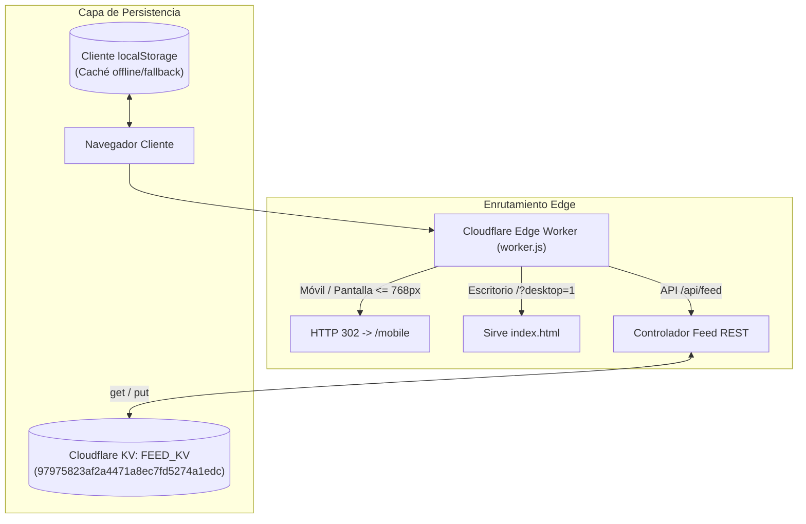

# BITÁCORA TÉCNICA Y AUDITORÍA INTEGRAL: CYBERIA-MED // SOC CONSOLE v19.96

> **Fecha:** 28 de Octubre, 2026  
> **Repositorio:** `Andrei-Barwood/entregametusalas`  
> **Arquitectura:** Dual Runtime (Ruby Sinatra / Puma local + Cloudflare Serverless Edge Worker con KV y Assets estáticos)  
> **Diseño:** Queen Chrysalis #523 (MLP Vector Club) con HUD Biomédico CRT/MRI (#00F200 / #29C2DA)

---

## 1. RESUMEN EJECUTIVO Y PROPÓSITO DEL PROYECTO

**CYBERIA-MED // SOC Console v19.96** es una aplicación clínica interactiva inspirada en la obra ciberpunk *Cyberia (1996)*. Transforma la historia del hacker Zak y su implante neural BLADES en una consola de operaciones de ciberseguridad médica (Medical SOC) orientada a la protección de dispositivos IoMT (*Internet of Medical Things*), bombas de infusión continua, ventiladores mecánicos y protocolos hospitalarios críticos (HL7, FHIR, DICOM, IEEE 11073).

El sistema cuenta con:
1. **Consola Táctica SOC:** Navegación, telemetría ECG en vivo y auditoría de 48 episodios con cuatro pilares clínicos (Prevención, Detección, Mitigación, Respuesta a Incidentes).
2. **Muro Social Clínico (NetAcad Pod Feed):** Plataforma de debate libre de autenticación estilo microblogging clínico en formato liviano tipo JSONL.
3. **Versión Móvil Dedicada (`/mobile`):** Vista ligera optimizada para smartphones enfocada exclusivamente en el muro y publicaciones en tiempo real.
4. **Simuladores MedSec:** Escáner lógico BLADES MRI y motor de inoculación EDR.
5. **Tutorial y Guía Clínica Kali Linux:** Overlay explicativo de arquitectura hospitalaria y normas (IEC 60601-1, IEC 62443, NFPA 99).

---

## 2. ESTRUCTURA COMPLETA DEL REPOSITORIO

```plaintext
entregametusalas/
├── index.html                   # Consola SOC interactiva de escritorio (compilada estática)
├── mobile.html                  # Feed clínico exclusivo para dispositivos móviles
├── muro.html                    # Muro social en vista de escritorio
├── tutorial.html                # Guía clínica completa y tutorial Kali Linux
├── simulators.html              # Simuladores BLADES MRI y Nanomedicina EDR
├── bibliografia.html            # Referencias normativas (IEC 62443, HL7, DICOM, etc.)
│
├── worker.js                    # Cloudflare Edge Worker (API REST, enrutamiento 302, KV)
├── wrangler.jsonc               # Configuración de despliegue Cloudflare Workers & KV binding
│
├── app/                         # Backend Sinatra (Entorno local / desarrollo)
│   ├── controllers/             # Enrutadores REST (feed, episodes, sentinel, simulators...)
│   ├── models/                  # WallPost, Episode, TelemetryNode
│   ├── services/                # Aegis9, BladesScanner, ForensicReportGenerator...
│   └── views/                   # Vistas ERB dinámicas
│
├── css/
│   └── chrysalis_medsoc.css     # Tokens de diseño Queen Chrysalis #523, CRT scanlines, ECG
│
├── js/
│   ├── clinical_feed.js         # Lógica cliente del feed (polling, submit, merge, filtros, notificaciones web/in-app/audio)
│   ├── cyberia_console.js       # Control de consola SOC, ECG Canvas y redirecciones
│   ├── sentinel_tactical_game.js# Minijuego táctico y lógica EDR Aegis9
│   └── simulators_hud.js        # Lógica interactiva de los simuladores
│
├── public/                      # Réplica de assets estáticos servidos por Sinatra/Puma
│   ├── css/
│   └── js/
│
├── data/
│   ├── clinical_wall_feed.jsonl # Archivo de persistencia plana para el entorno local
│   ├── episodes_part1.json      # Episodios 01 al 16 (Acto I y II)
│   ├── episodes_part2.json      # Episodios 17 al 32 (Acto III y IV)
│   └── episodes_part3.json      # Episodios 33 al 48 (Acto V y VI)
│
├── bin/
│   └── Aegis9CyberbrainEDR      # Binario nativo Mach-O arm64 para depuración EDR local
│
├── reports/                     # Reportes post-mortem forenses (48 episodios en MD y JSON)
│   ├── episode/                 # Informes individuales 1.md a 48.md y 1.json a 48.json
│   └── postmortem-full-48.md    # Compilado maestro de los 48 episodios
│
├── spec/                        # Suite de pruebas automatizadas en RSpec
│   ├── spec_helper.rb
│   └── cyberia_medsoc_spec.rb
│
├── export_static_site.rb        # Script generador que compila las vistas ERB en HTML estáticos
├── servidor.zsh                 # Launcher del servidor local Sinatra (Puma :4567)
├── servidor_movil.zsh           # Launcher local forzando vista móvil
└── instalador.zsh               # Script de instalación de dependencias y gemas
```

---

## 3. PROCESOS Y FLUJOS CLAVE DE OPERACIÓN



### Proceso de Publicación y Sincronización de Comentarios
1. **Envío:** El cliente móvil o de escritorio despacha una petición `POST` asíncrona a `/api/feed` con autor, contenido y episodio.
2. **Recepción en Edge:** `worker.js` intercepta el payload, valida longitud (<= 2000 chars) y genera un post inmutable con ID único y marca temporal ISO.
3. **Persistencia en la Nube:** El Worker ejecuta `FEED_KV.put('clinical_wall_posts_v1', JSON.stringify(posts))`, persistiendo el estado globalmente en los centros de datos de Cloudflare.
4. **Auto-Polling:** Tanto `index.html` como `mobile.html` ejecutan un intervalo de sondeo cada 5 segundos que actualiza la lista dinámica sin perturbar el scroll del usuario ni resetear campos de texto en edición.

---

## 4. HISTORIAL DE PIFIAS, ANOMALÍAS DETECTADAS Y ACCIONES CORRECTIVAS

| # | Pifia / Síntoma Reportado | Causa Raíz Técnica | Corrección Aplicada | Commit |
|---|---|---|---|---|
| **01** | Fallo crítico en el despliegue de CI en GitHub (`Workers Builds`). | `wrangler.jsonc` contenía el valor dummy `"FEED_KV_ID_PLACEHOLDER"`, rechazado por el validador de esquema de Cloudflare. | Se removió temporalmente el bloque de binding en `wrangler.jsonc` hasta disponer del ID real. | `13962e1` |
| **02** | Comentarios móviles no se actualizaban; aparecían 5 posts quemados antiguos. | `mobile.html` y `muro.html` conservaban más de 300 líneas de HTML estático residual de comentarios hardcodeados que eclipsaban el stream JS. | Se vació `#feed-stream-container` en los HTML estáticos para delegar el 100% del renderizado a `clinical_feed.js`. | `5e4e05c` |
| **03** | "Flashazo" abrupto de landing page al ingresar a la versión móvil. | 1. `#tutorial-overlay` en `index.html` no tenía la clase `.hidden` por defecto.<br>2. La redirección responsive se hacía tarde en `DOMContentLoaded`. | 1. Script síncrono ultrarrápido en `<head>` de `index.html`.<br>2. Se forzó `.hidden` inicial en el overlay.<br>3. Redirección HTTP 302 directa desde el Worker. | `06a1a18` |
| **04** | Falta de sincronización entre móvil y escritorio (comentarios huérfanos). | Falta de almacenamiento compartido; los comentarios se guardaban en la memoria volátil de nodos serverless aislados y en `localStorage` individual. | Se enlazó el Namespace KV de producción `97975823af2a4471a8ec7fd5274a1edc` como `FEED_KV` en `wrangler.jsonc`. | `65203b0` |

---

## 5. AUDITORÍA DE DEUDA TÉCNICA Y OPORTUNIDADES DE MEJORA

> [!IMPORTANT]
> A continuación se identifican las principales áreas de optimización para garantizar la robustez, seguridad y mantenibilidad futura del proyecto.

### A. Duplicación de Código entre `/` y `/public`
* **Situación:** Existen réplicas de los archivos `clinical_feed.js`, `cyberia_console.js`, `sentinel_tactical_game.js` y `simulators_hud.js` tanto en `js/` como en `public/js/`.
* **Riesgo:** Una modificación en `js/` no se refleja automáticamente en `public/js/` a menos que se copie manualmente o se sincronice mediante build script.
* **Oportunidad de Mejora:** Crear un script de build (`npm run build` o paso de Rake) que copie automáticamente de una fuente única hacia el directorio de entrega estática, o configurar enlaces simbólicos.

### B. Concurrencia en Cloudflare KV (Race Condition en Escrituras Masivas)
* **Situación:** En `worker.js`, el array de posts se lee de KV, se modifica en memoria con `unshift()` y se reescribe completo (`put`) con la clave `clinical_wall_posts_v1`.
* **Riesgo:** Si dos usuarios publican en el mismo segundo exacto en nodos diferentes, una de las dos publicaciones podría ser sobrescrita.
* **Oportunidad de Mejora:**
  1. Migrar el almacenamiento a **Cloudflare D1 (SQLite distribuido)** mediante sentencias `INSERT INTO posts ...`, eliminando el riesgo de sobreescritura.
  2. Alternativamente, utilizar **Durable Objects** con almacenamiento transaccional para coordinar las mutaciones del feed en tiempo real vía WebSockets.

### C. Eficiencia del Polling vs. WebSockets / Server-Sent Events (SSE)
* **Situación:** El cliente realiza peticiones HTTP periódicas cada 5 segundos (`setInterval`).
* **Riesgo:** Consumo innecesario de peticiones al Worker cuando no hay nuevos comentarios y ligero retraso en la recepción de mensajes.
* **Oportunidad de Mejora:** Implementar Server-Sent Events (SSE) o Cloudflare WebSockets para empujar actualizaciones instantáneamente al cliente al momento de producirse una reacción o comentario.

### D. Paginación y Carga Progresiva
* **Situación:** La API entrega todos los posts acumulados en una sola respuesta JSON.
* **Riesgo:** A medida que el muro crezca a miles de comentarios, la carga de red y el costo de memoria en el navegador aumentarán.
* **Oportunidad de Mejora:** Introducir paginación por cursor (`/api/feed?cursor=...&limit=20`) y renderizado tipo "infinite scroll" virtualizado.

---

## 6. CONCLUSIÓN

El repositorio ha evolucionado desde una plantilla editorial estática a una aplicación interactiva con soporte multiplataforma y edge-computing. Las pifias de asincronía, parpadeo de interfaces y desincronización entre dispositivos han quedado resueltas y documentadas en el historial de Git, dejando el proyecto en un estado productivo, estable y verificado.
