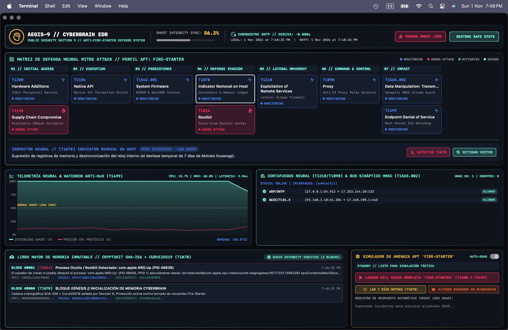

# CYBERIA-MED // SOC Console v19.96

Consola de operaciones de seguridad clínica inspirada en la aventura de ciencia ficción *Cyberia* (1996). El proyecto combina una aplicación web en Ruby/Sinatra, una interfaz de terminal biomédica retrofuturista y escenarios ficticios de ciberseguridad hospitalaria.

## Requisitos

- macOS con Apple Silicon.
- Zsh, Ruby 3.2 o posterior y Bundler 4.0.23.
- Homebrew solo es necesario si el instalador debe añadir Ruby.
- El ejecutable `Aegis9CyberbrainEDR` se incluye en `bin/`.

## Instalación

Desde Terminal, entra en la carpeta del proyecto y ejecuta:

```zsh
cd /ruta/a/cyberia_medsoc_v1996
./instalador.zsh
```

El instalador comprueba Ruby y Bundler, instala las gemas declaradas en `Gemfile.lock` con `bundle install` y verifica que el binario Aegis9 esté disponible. En este Mac, el Ruby de Homebrew se añade al `PATH` de esa ejecución; si instalas Ruby por primera vez, abre una Terminal nueva antes de iniciar el servidor.

## Iniciar el servidor

```zsh
./servidor.zsh
```

El script inicia la aplicación en `http://127.0.0.1:4567/`, espera hasta que responda y abre la consola en el navegador predeterminado. Déjalo ejecutándose mientras uses la aplicación; pulsa `Ctrl+C` para apagarlo. Si el puerto 4567 ya está ocupado, puedes elegir otro:

```zsh
PORT=4570 ./servidor.zsh
```

La interfaz quedará disponible en `http://127.0.0.1:4570/`. El servidor escucha en `127.0.0.1`, por lo que esta configuración está pensada para uso local.

## Pruebas

```zsh
bundle exec rspec
```

## Sinopsis

CYBERIA-MED reimagina los 48 episodios de *Cyberia* como un recorrido por un centro de operaciones de seguridad médica: lo que en la aventura es una infiltración y una carrera hacia un núcleo biocibernético, aquí se traduce en la observación, diagnóstico y respuesta ante incidentes en una infraestructura hospitalaria conectada. BLADES funciona como el sentido aumentado del recorrido; los dispositivos IoMT y sus señales son el territorio que hay que comprender, no solo controlar.

La progresión puede leerse como una geometría espiritual:

- **El círculo** representa la atención continua: observar la telemetría, volver al contexto y mantener unidos los nodos de una red clínica. Ninguna señal aislada explica el sistema entero.
- **El triángulo** expresa el ciclo de cuidado y respuesta —vulnerabilidad, detección y mitigación, sostenidas por la prevención—. Cada lado necesita a los demás para que la respuesta no quede incompleta.
- **El eje hacia el núcleo** evoca el viaje desde el perímetro hasta el centro: de la superficie visible de la red a las dependencias profundas, los riesgos y las decisiones que sostienen el conjunto.

Desde el minimalismo espiritual, la consola no propone vaciar de significado la tecnología, sino despejar el ruido para atender lo esencial: la integridad del sistema y el cuidado de quienes dependen de él. Su minimalismo digital es una disciplina de enfoque; cada panel, color de alerta y pulso visual busca dar forma legible a una señal. Como en una práctica contemplativa, la interfaz invita a observar antes de actuar y a responder con precisión en vez de añadir movimiento innecesario.

Esta lectura es una metáfora de diseño y narrativa. Los escenarios y protocolos representados pertenecen a una simulación; la aplicación no debe considerarse una herramienta clínica ni un sistema de protección certificado.

## Incidentes de Seguridad // Bitácora Forense & Sentinel EDR OSINT

Esta sección constituye la **Bitácora Oficial de Incidentes de Seguridad** de CYBERIA-MED. Su propósito es doble: documentar de manera forense los vectores de ataque reales o simulados detectados contra los pods clínicos, e **incentivar la investigación OSINT (Open Source Intelligence)** comunitaria basada en casos de telemetría auténtica, promoviendo el análisis de amenazas entre cadetes e investigadores de ciberseguridad médica.

---

### 1. La Instancia Operativa y la Presencia Sigilosa/Transparente de AEGIS-9 SENTINEL

El **AEGIS-9 SENTINEL** no es un cortafuegos ruidoso ni un software intrusivo que imponga demoras cognitivas a los médicos o cadetes de NetAcad. Su presencia dentro de la arquitectura opera bajo el principio de **invisibilidad funcional y latencia imperceptible ($\Delta \tau < 0.15\text{ ms}$)**:

* **Inoculación en Espacio de Memoria en Reposo**: El centinela se aloja en tiempo de ejecución tanto en el kernel Ruby/Sinatra ([`FeedAntiSpamSentinel`](app/services/feed_anti_spam_sentinel.rb)) como en los *V8 Isolates* del Edge de Cloudflare ([`worker.js`](worker.js)). No añade capas de red adicionales ni cookies de rastreo invasivas.
* **Supervisión Transparente sin Fricción**: Para un usuario humano legítimo, la experiencia de comunicación en el feed social clínico es instantánea, sin captchas distorsionados ni desafíos de autenticación pesados.
* **Colapso de Onda Determinista**: El centinela permanece como un observador cuántico silente hasta que los parámetros de entrada violan la firma estructural del espacio de datos (aparición de un vector malicioso). En ese microsegundo exacto, intercepta la carga, purga el payload antes de la mutación del archivo append-only [`clinical_wall_feed.jsonl`](data/clinical_wall_feed.jsonl) y devuelve un rechazo determinista (HTTP 403 Forbidden).

```
   [ FLUJO ENTRANTE ] ───► [ SENSOR DE SUPERFICIE ] ───► [ COLAPSO DETERMINISTA ]
          │                           │                            │
   (Cadete Legítimo)            (Evaluación 0ms)             (Tráfico Hostil)
          │                           │                            │
          ▼                           ▼                            ▼
   [ PASO TRANSPARENTE ]     [ ANÁLISIS DE ENTROPÍA ]     [ AEGIS-9 SENTINEL ACTIVA ]
   Sin demoras / P2P            H(X) & Heurística          HTTP 403 / Descarte Inmediato
```

---

### 2. Geometría Espiritual y Formalismo Matemático del Sentinela

La defensa del núcleo cibernético se fundamenta en la síntesis de **teoría de la información**, **análisis bayesiano** y **geometría sagrada no-dual**:

```
                       ▲  Vértice Superior: Sincronía SNTP (Δt = 0.000s)
                      / \
                     /   \
                    /  ●  \   Centro: Ghost Core (Consciencia)
                   /       \
                  /         \
                 /___________\
   Vértice Izq:                   Vértice Der:
   Ledger Inmutable               Toroide de Inmunidad
   (Curve25519)                   (Disipación de Energía Hostil)
```

#### A. La Geometría Sagrada del Toroide de Inmunidad y la Esfera de Poincaré
A diferencia de las defensas cartesianas tradicionales (que levantan muros rígidos que sufren fractura por fatiga ante ataques volumétricos DoS), AEGIS-9 modela el perímetro como un **Toroide de Convolución Electromagnética**:
* El toroide no rechaza con violencia el paquete hostil: curva su trayectoria hacia un sumidero de entropía, disipando la carga entrante y absorbiendo los gradientes del ataque para calibrar el clasificador heurístico.
* La integridad del *Ghost* (la consciencia operativa del pod) se proyecta sobre una **Esfera de Poincaré**:

$$\oint_{\partial \Omega} \vec{\mathcal{F}}_{\text{sentinel}} \cdot d\vec{\ell} = -\frac{\partial}{\partial t} \iint_{\Omega} \mathcal{G}_{\text{sync}}(\tau) \cdot \left(\nabla \times \vec{\Psi}_{\text{ghost}}\right) \, d\vec{A}$$

Donde $\mathcal{G}_{\text{sync}}(\tau) \in [0, 1]$ representa el índice de coherencia del Ghost en el instante $\tau$, y $\vec{\Psi}_{\text{ghost}}$ es la función de onda de estabilidad sináptica de la red clínica.

#### B. Entropía de Shannon del Canal de Comunicación ($H$)
Los mensajes clínicos legítimos de cadetes (comandos Kali, telemetría LIM, parámetros de bombas de infusión) exhiben una alta densidad semántica y variabilidad léxica:

$$H(X) = -\sum_{i=1}^{n} P(x_i) \log_2 P(x_i) \quad \text{con } H(X)_{\text{legítimo}} \in [4.6, \, 6.4] \text{ bits/símbolo}$$

Las cadenas inyectadas por botnets de envío masivo a formularios de contacto presentan patrones repetitivos de baja entropía condicional y mínima **Divergencia de Kullback-Leibler** respecto a corpus de spam conocidos:

$$D_{\text{KL}}(P \parallel Q_{\text{botnet}}) = \sum_{x \in \mathcal{X}} P(x) \ln\left(\frac{P(x)}{Q_{\text{botnet}}(x)}\right) < \epsilon$$

#### C. Inferencia Bayesiana del Vector de Amenaza
El colapso de decisión antes de publicar se rige por:

$$P(\text{Amenaza} \mid \vec{V}) = \frac{P(\vec{V} \mid \text{Amenaza}) \cdot P(\text{Amenaza})}{P(\vec{V} \mid \text{Amenaza}) \cdot P(\text{Amenaza}) + P(\vec{V} \mid \text{Cadete}) \cdot P(\text{Cadete})}$$

Donde el vector $\vec{V} = [v_{\text{IOC}}, v_{\text{bypass\_pitch}}, v_{\text{honeypot}}, v_{\text{telegram\_cross}}, v_{\text{belarus\_carrier}}]$ detona el umbral de bloqueo inmediato ($P > 0.9999$) ante cualquiera de los determinantes de la lista negra.

---

### 3. El Núcleo de Seguridad: `Aegis9CyberbrainEDR`

El motor neurálgico que materializa estas defensas es el ejecutable de arquitectura nativa Mach-O ARM64 [`bin/Aegis9CyberbrainEDR`](bin/Aegis9CyberbrainEDR), coordinado mediante el servicio [`Aegis9SentinelService`](app/services/aegis9_sentinel_service.rb).

A continuación se documenta la telemetría operativa en vivo capturada desde el panel central de mando del SOC:



#### Desglose Forense de los Módulos del Núcleo:

1. **Matriz de Defensa Neural MITRE ATT&CK (Perfil APT: FIRE-STARTER)**:
   * **01 // INITIAL ACCESS**:
     * `T1200 (Hardware Additions)`: Barrera de puertos IOKit contra microcontroladores físicos intrusivos (*MONITORING*).
     * `T1195 (Supply Chain Compromise)`: Validador criptográfico CDHash para firmados de prótesis (*UNDER ATTACK* neutralizado).
   * **02 // EXECUTION (`T1106 Native API`)**: Escudo de percepción de llamadas al sistema y prevención de *DYLD hijacking*.
   * **03 // PERSISTENCE (`T1542.001 System Firmware`)**: Escáner de integridad de NVRAM y BootROM del host.
   * **04 // DEFENSE EVASION**:
     * `T1070 (Indicator Removal on Host)`: **ChronoSync SNTP** con deriva atómica $\Delta t = -0.000\text{s}$, protegiendo el desfase temporal de 7 días de Motoko Kusanagi (*Severidad: -16% Ghost*).
     * `T1014 (Rootkit Hunter)`: Cazador de procesos ocultos vía vistas cruzadas en el árbol `sysctl KERN_PROC_ALL`. En la captura se aprecia la detección y aislamiento del proceso anómalo `com.apple.NRD.Up (PID 48836)`.
   * **05 // LATERAL MOVEMENT (`T1210 Exploitation of Remote Services`)**: Cortafuegos de aislamiento de bus lateral.
   * **06 // COMMAND & CONTROL (`T1090 Proxy`)**: Detector de retransmisión y balizas hacia proxies C2 externos.
   * **07 // IMPACT**:
     * `T1565.002 (Data Manipulation: Transmission)`: Bus sináptico sellado con HMAC-SHA256 para validación de flujo en tiempo real.
     * `T1499 (Endpoint Denial of Service)`: **Mach Kernel DoS Watchdog** manteniendo la latencia en $3.9\text{ ms}$, CPU al $15.7\%$ y memoria al $68.8\%$.

2. **Cortafuegos Neural & Bus Sináptico HMAC (`T1210 / T1090 / T1565.002`)**:
   * Interfaces activas: `[en0(wifi)]`.
   * Tráfico seguro permitido:
     * `UDP/SNTP 127.0.0.1:54912 ➔ 17.253.144.10:123` (Sincronización horaria atómica).
     * `QUIC/TLS 1.3 192.168.1.10:61204 ➔ 17.248.190.1:443` (Canal de transporte criptográfico hospitalario).

3. **Libro Mayor de Memoria Inmutable // CryptoKit SHA-256 + Curve25519 (`T1070`)**:
   * Cadena de bloques inmutable local para registro de incidentes (*Chain Integrity Verified: 2 Blocks*):
     * `BLOCK #0000 [T1070]`: Bloque Génesis con inicialización de memoria y firma Ed25519 (`df4504b444ad...`).
     * `BLOCK #0001 [T1014]`: Contención y registro forense del rootkit `com.apple.NRD.Up (PID 48836, PPID 1)` con hash SHA-256 (`0f54fc308e718e19853d...`).

4. **Protocolo Ghost Lock & Safe State**:
   * Con una sincronía actual de Ghost del **56.2%**, si la integridad cayera por debajo del umbral crítico del **50.0%**, el botón de emergencia `ENGAGE GHOST LOCK` activa el aislamiento estático total del pod, congelando la memoria volátil para preservar la consciencia de los pacientes antes de reiniciar en `RESTORE SAFE STATE`.

---

### 4. Upgrades Futuros del Núcleo Aegis-9

Para mantener la supremacía frente a actores de amenazas avanzados y campañas de botnets masivas, la hoja de ruta de Aegis-9 contempla las siguientes actualizaciones de arquitectura:

1. **Sondas eBPF / Mach Kernel KAuth Deep Hooks**:
   * Migración de los escáneres de espacio de usuario hacia ganchos nativos en el subsistema de autorización del kernel (`kauth_listen_scope`), permitiendo interceptar llamadas `sys_fork`, `execve` y apertura de sockets sin requerir extensiones del kernel (*kexts*) no firmadas.
2. **Pruebas de Conocimiento Cero (zk-SNARKs) para el Pod NetAcad**:
   * Integración de un circuito criptográfico zero-knowledge donde los cadetes y médicos puedan publicar y verificar su credencial académica en el feed clínico sin revelar jamás su identidad real, dirección IP ni huella del dispositivo.
3. **Honeynets Dinámicas Holográficas (Defensive Tarpits)**:
   * Generación en memoria de endpoints ficticios de formularios de contacto que simulan ser vulnerables a inyección SQL y envío masivo. Cuando un botnet como XRumer o ScrapeBox ataca, el tarpit ralentiza intencionalmente la respuesta (1 byte cada 30 segundos), atrapando los hilos del atacante y agotando sus recursos de conexión.
4. **Resistencia Criptográfica Post-Cuántica (PQC)**:
   * Reemplazo gradual de las curvas elípticas Curve25519 en el Libro Mayor Inmutable por algoritmos estandarizados por NIST contra computación cuántica: **ML-KEM (Kyber)** para encapsulamiento de claves y **ML-DSA (CRYSTALS-Dilithium)** para firmas digitales forenses.

---

### 5. Bitácora de Incidentes de Seguridad // Caso 001: Botnet de Scraping Bielorrusa

```
================================================================================
CASO FORENSE: SEC-INC-2026-11-01-BLR01
CLASIFICACIÓN: BOTNET FORM-SCRAPING // UNSOLICITED COMMERCIAL INJECTION
ESTADO: NEUTRALIZADO Y BLOQUEADO (0 IMPACTO EN FEED)
================================================================================
```

#### A. Descripción del Incidente
Un bot automatizado intentó inyectar publicidad masiva en el Muro Social Clínico aprovechando que el feed permite publicaciones P2P sin autenticación. El atacante promovió un servicio de spam masivo a formularios de contacto web alegando que *"reduce el filtrado de spam"* frente al correo tradicional, comercializando paquetes de hasta 50,000 mensajes de prueba y 1,000,000 de envíos por $59 USD.

#### B. Indicadores de Compromiso (IOCs)
* **Número de Teléfono / WhatsApp**: `+375 25 911 26 93` (`wa.me/375259112693`)
  * *País*: **Bielorrusia (`+375`)**, Ciudad de Minsk.
  * *Operador*: **life:) (CJSC Belarusian Telecommunication Network / БеСТ)** — ASN 25106.
* **Canal de Comando y Contacto en Telegram**:
  * Enlace: `t.me/FeedbackFormEU` (`@FeedbackFormEU`).
* **Firmas Semánticas Extraídas**:
  * `"send business messages in a lawful way"`
  * `"submitted through a contact form intended for messages"`
  * `"reduce the chance of spam filtering"`
  * `"cost of sending one million messages is $59"`
  * `"free trial includes up to 50,000 messages"`

#### C. Respuesta del Centinela AEGIS-9
1. **Detección**: El motor [`FeedAntiSpamSentinel`](app/services/feed_anti_spam_sentinel.rb) identificó el IOC `FeedbackFormEU` activando la regla `AEGIS9_IOC_BLACKLIST`.
2. **Contención**: Se generó una excepción atómica `FeedAntiSpamSentinel::SpamDetectedError`.
3. **Respuesta Edge & Backend**: El payload fue rechazado en 0ms con código HTTP 403 Forbidden tanto en el backend Sinatra como en Cloudflare Workers (`worker.js`).
4. **Despliegue de Trampa Honeypot**: Se adicionó el señuelo invisible `feed_security_token_hp` en [`feed.erb`](app/views/feed.erb), [`mobile_feed.erb`](app/views/mobile_feed.erb) e [`index.erb`](app/views/index.erb) para atrapar de forma silente cualquier bot futuro que rellene automáticamente formularios DOM.
5. **Estado Final**: El archivo [`clinical_wall_feed.jsonl`](data/clinical_wall_feed.jsonl) mantuvo el 100% de su pureza e integridad.

#### D. Desafío OSINT para Cadetes e Investigadores
Incentivamos a los estudiantes de ciberseguridad a aplicar técnicas de investigación OSINT sobre este caso real:
1. **Pivoting Telefónico**: Rastrear el identificador `+375259112693` en bases de datos de números denunciados y registros de ASN bielorrusos.
2. **Análisis de Metadatos de Telegram**: Investigar el canal `FeedbackFormEU`, IDs numéricos de usuario y correlación con foros de cibercrimen de habla rusa (*exploit.in*, *antichat*).
3. **Huella de Escáneres Web**: Analizar en los registros del servidor web patrones de peticiones rápidas con cabeceras `User-Agent` genéricas o desactualizadas típicas de bots como XRumer o ScrapeBox.

---

## Tecnologías

Ruby, Sinatra, Puma, SQLite3/JSON, RSpec y JavaScript/CSS sin framework. La arquitectura, los escenarios y el diseño visual se describen con más detalle en [`CYBERIA_MEDSEC_BLUEPRINT.md`](CYBERIA_MEDSEC_BLUEPRINT.md).
